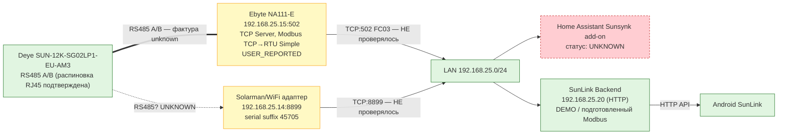

# Stage 17 — Аудит топологии RS485 и безопасности физического доступа

**Статус:** выполнено. Исключительно документальный/static аудит.
**HEAD на начало и конец:** `eb565d44970faa55043bf8b83f8773ed0f5e8a43` (= `origin/main`).
**Физические и сетевые проверки оборудования НЕ выполнялись.**

## 0. Прямое подтверждение ограничений

На Stage 17 **не выполнялись**: TCP/ping/nmap/nc/telnet/curl к `192.168.25.14` или
`192.168.25.15`; проверки портов 8899/502; Modbus-запросы (FC03/FC04 и др.);
подключения к HA; остановка/запуск HA; изменение Ebyte, Solarman-адаптера,
инвертора, RS485-проводки, production backend, `.env`, systemd, Redis, firewall,
MikroTik; активация `SUNLINK_DATA_SOURCE=modbus`. Все выводы основаны на файлах
репозитория и Git-истории. Production `.env` не читался; секреты в отчёт не включены.

## 1. Исходное состояние Git

| Проверка | Значение |
|---|---|
| Рабочая директория | `/root/opt/sunlink-svitgrid` |
| Ветка | `main` |
| HEAD | `eb565d44970faa55043bf8b83f8773ed0f5e8a43` |
| origin/main | совпадает |
| HEAD ожидаемый | совпадает |
| Источники | чистые; build-артефакты сохранены |

## 2. Инвентаризация источников сведений

| Источник | Что даёт | Достоверность |
|---|---|---|
| `docs/stages/stage-9.2-official-protocol-documentation.md` | Официальные мануалы Deye (55 стр.) и Ebyte (51 стр.); RS485 pinout; factory defaults; нет карты регистров Deye; один master in Simple mode | CONFIRMED (документы) |
| `docs/stages/stage-9.3-network-topology-and-master-audit.md` | Таблица IP/портов, две сетевые цепочки, Mermaid | PARTIAL — часть утверждений позже понижена до UNKNOWN |
| `docs/stages/stage-9.3.1-evidence-reconciliation.md` | Авторитетная сверка: Slave ID, HA, физическая топология, нехватка первичных логов | CONFIRMED (аудит) |
| `docs/stages/stage-6-ha-register-cross-check.md` | Лог HA Sunsynk: serial suffix `45705`, Modbus ID `1`, `solarman-tcp://192.168.25.14:8899`, single-phase, 12000 W | CONFIRMED (документ лога) |
| `docs/stages/stage-3-first-real-read.md`, `stage-4-modbus-display-verification.md` | Утверждения об успешных FC03 через Ebyte | REPORTED — нет первичного лога в репозитории |
| `docs/equipment.md`, `docs/architecture.md`, `README.md` | Настройки Ebyte, ограничение одного master, адреса сервисов | USER_REPORTED / CONFIRMED (документ) |
| `sunlink-svitgrid/server/deye_gateway.py` | CONFIG modbus host/port/slave, read-only код | CONFIRMED (код) |
| `sunlink-svitgrid/server/config.yaml` | Сейчас безопасный шаблон источника (этап 16), не production | CONFIRMED (код) |
| `docs/stages/stage-16-real-data-pipeline.md` | Единый TelemetrySource, DEMO по умолчанию, modbus только с явным флагом | CONFIRMED (код + тесты) |
| Git history (`git log`) | Хронология этапов 3–16, без первичных логов FC03 | CONFIRMED |

## 3. Реконструированная топология

**Подтверждено как сетевые endpoint (разные):**
- `192.168.25.14:8899` — Solarman TCP, HA Sunsynk add-on (лог HA, stage 6);
- `192.168.25.15:502` — Ebyte NA111-E, Modbus TCP Server → RTU (user-reported);
- `192.168.25.20` — backend SunLink/SvitGrid (документы);
- `192.168.25.117` — OpenCode host / локальный gateway (контекст).

**НЕ подтверждено:** является ли это одной физической RS485-шиной или двумя;
какой адаптер реально подключён к инвертору; как соединены A/B/GND; остановлен ли HA;
Unit ID 1 для текущего подключения.

### Mermaid-схема

Пунктир = UNKNOWN. Нельзя трактовать две разные пары IP:port как доказательство
двух физических шин.

### Анализ возможных вариантов (без выбора)

| Вариант | Подтверждают | Противоречат / не хватает | Риск при одновременном опросе |
|---|---|---|---|
| 1. Два независимых адаптера | Разные IP и порты; разные протоколы (Modbus TCP vs Solarman TCP) | Нет схемы проводки | Низкий при действительно разных шинах, но это не доказано |
| 2. Один адаптер, два сервиса | Разные протоколы могут быть на одном устройстве | Нет данных о перенаправлении портов | Два master на одной шине — коллизии |
| 3. Второй адаптер не используется | Нет упоминаний активного использования `.14` | Текущий статус HA UNKNOWN | Риск проснувшегося клиента |
| 4. Оба на одной RS485-шине | Физически возможно | Нет схемы | **Высокий**: коллизии, тайм-ауты, неверные ответы |
| 5. Один endpoint устарел | stage-3/4 упоминают остановку HA | User-reported, нет проверки | Неизвестно |
| 6. Топология невосстановима | Нет первичных доказательств | — | Любой опрос безопасен только после уточнения |

Вариант не выбирается: доказательств недостаточно.

## 4. Статус Home Assistant

**UNKNOWN.** Документы этапов 3–4 сообщают (user-reported), что HA Sunsynk был
остановлен перед физическими тестами. Stage 6 сообщает, что HA не останавливался
и не перезапускался. Stage 9.3.1 прямо устанавливает текущий статус `UNKNOWN`.
Сетевые проверки статуса на Stage 17 запрещены и не выполнялись.

## 5. Статус Ebyte NA111-E

Все параметры — **PREVIOUSLY REPORTED / USER_REPORTED**, не подтверждены текущим
состоянием устройства:

| Параметр | Значение | Статус |
|---|---|---|
| IP | `192.168.25.15` | Previously reported |
| TCP port | `502` | Previously reported |
| Mode | TCP Server | Previously reported |
| UART baud | `9600` | Previously reported |
| Data bits / Parity / Stop | `8` / None / `1` | Previously reported |
| Protocol | Modbus TCP → RTU Open | Previously reported |
| Working mode | Simple | Previously reported |
| Timeout | `1000 ms` | Previously reported |
| Address filter | `0` | Previously reported |
| Polling interval | `0` | Previously reported |
| Keep time | `10 s` | Previously reported |

Официальные factory defaults (мануал, стр. 5): `192.168.3.7:8887`, `115200 8N1`,
TCPServer. Необходимо визуальное подтверждение владельцем в веб-интерфейсе
устройства (самостоятельно интерфейс не открывался). Протокольный факт из мануала:
режим Simple допускает **только одного Modbus master**.

## 6. Статус Unit ID / адресации

| Сведение | Источник | Статус |
|---|---|---|
| Modbus ID `1` в конфигурации HA Sunsynk | лог HA (stage 6) | CONFIRMED (документ) |
| Serial suffix `45705` | лог HA (stage 6) | CONFIRMED (документ) |
| `device_id=1` в диагностических скриптах | stage 3/4 | REPORTED (документ) |
| Успешный FC03 через Ebyte именно с Unit ID 1 | stage 3/4 | **UNKNOWN** — нет первичного лога в репозитории |
| Unit ID текущего физического подключения | — | **UNKNOWN** |

`Unit ID = 1` не считается подтверждённым для CURRENT топологии.

## 7. Риск нескольких Modbus master

Один активный master на физической RS485-шине — требование документации Ebyte
(CONFIRMED). При двух мастерах возможны: коллизии кадров, тайм-ауты,
искажённые/перепутанные ответы, ложные значения телеметрии. Моментальное
отсутствие TCP-соединения (даже если бы оно проверялось) не доказывает отсутствие
другого мастера — нужен мониторинг и подтверждение владельца.

## 8. Вопросы владельцу

1. Подтверждён ли текущий статус HA Sunsynk: остановлен или активен?
2. Относятся ли `.14:8899` и `.15:502` к одной физической RS485-шине?
3. Какой адаптер физически подключён к инвертору сейчас?
4. Распиновка A/B/GND и количество адаптеров на шине?
5. Текущие IP/порт/baud/режим NA111-E (визуально в веб-интерфейсе)?
6. Подтверждён ли Unit ID 1 для текущего подключения?
7. Есть ли другие Modbus-клиенты в сети (помимо HA и SunLink)?
8. Первичный лог/вывод скриптов этапов 3–4 для подтверждения успешного FC03?
9. Соответствует ли baud 9600 8N1 настройкам инвертора?

## 9. Сопоставление с Stage 16

Статическая проверка подтвердила:

- `SUNLINK_DATA_SOURCE` по умолчанию `demo`;
- `modbus` требует `SUNLINK_ENABLE_MODBUS=1`, иначе понятная ошибка;
- неизвестное значение источника отвергается;
- write-интерфейсов нет в `TelemetrySource`, mock-транспорте и gateway;
- write-эндпоинтов нет в API;
- источник помечается в каждой measurement (`demo_simulator`/`mock`/`deye_modbus`);
- HA не используется как источник данных runtime-кодом.

Проблем не обнаружено. Modbus не активировался, production-конфигурация не менялась.

## 10. Условия допуска к будущему физическому тесту (план НЕ выполняется)

Два отдельных условия:
1. Владелец письменно подтверждает физическую топологию и отсутствие других
   активных Modbus master на этой RS485-шине.
2. Владелец отдельно разрешает конкретный READ-ONLY тест.

План: один master/один клиент; строго FC03; только чтение; без FC05/06/15/16;
ограниченный список адресов (9 регистров stage 7); ограниченные повторы; timeout;
остановка при ошибках связи; сохранение исходных ответов; сверка с дисплеем
инвертора; без автоматического fallback на DEMO. **Ни один шаг плана на Stage 17
не выполнялся.**

## 11. Ограничения проверки

- Нет физического опроса, сетевых проверок и scans.
- Нет правок production, HA, Ebyte, инвертора.
- Статусы UNKNOWN оставлены UNKNOWN намеренно.
- Документ не утверждает, что реальные данные получены.
